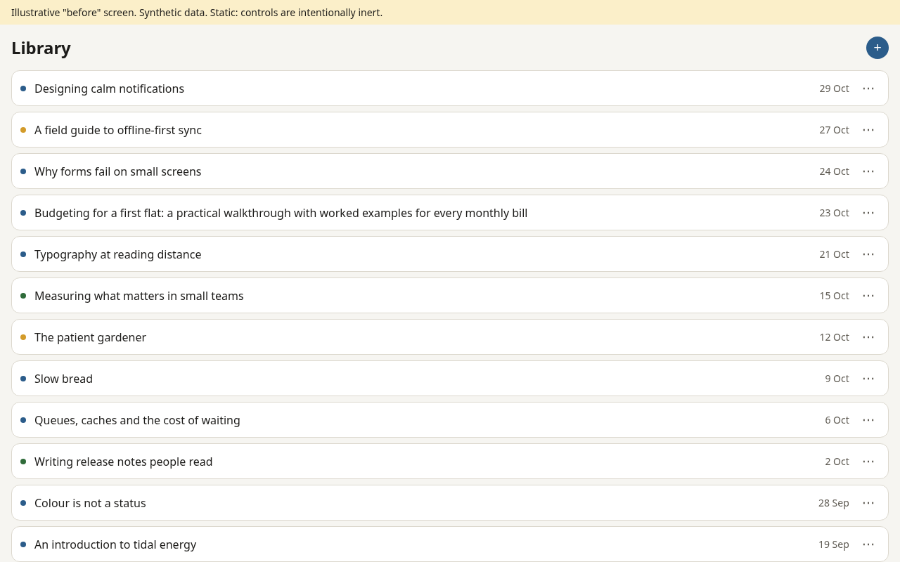
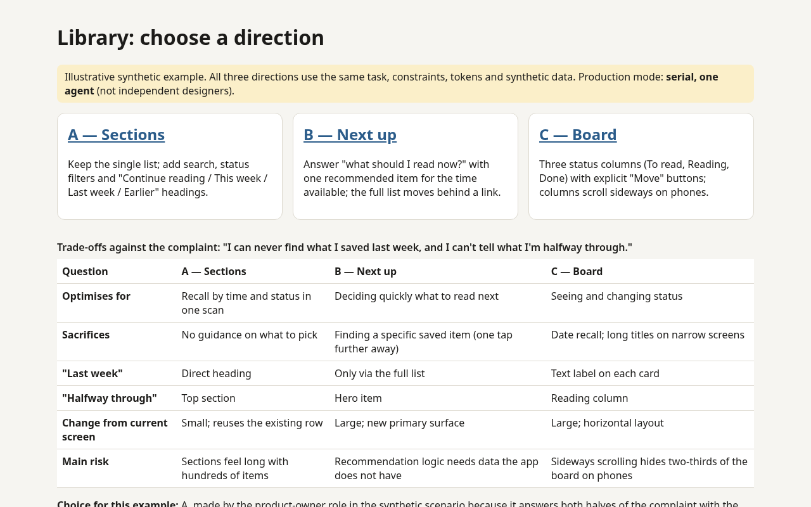
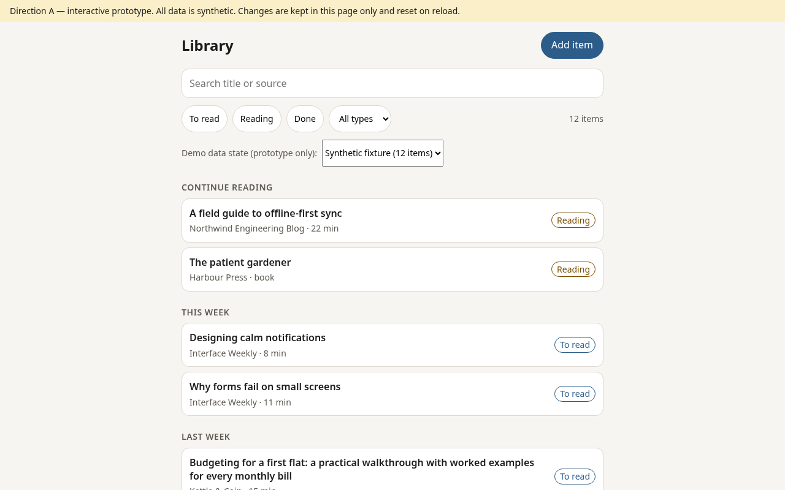

# design-agent-kit

Two portable skills for evidence-based interface critique and working design prototypes:

- **`senior-design-review`** — turns "make this screen better" into an evidence-based critique (structure, hierarchy, actions, gestures, visuals, accessibility) and a buildable specification with a Cut / Add / Revise / Keep ledger.
- **`interactive-mockup`** — produces two or three genuinely different design directions, lets you choose, then builds a working offline HTML prototype of your pick without quietly redesigning it.

Works with Claude Code, Codex, Hermes, or any agent that can read Markdown files. Plain files, MIT licence, no dependencies, no network, no telemetry.

**See it first:** open [examples/reading-list/](examples/reading-list/README.md) — a synthetic before/after walk-through with a full review, three directions, a comparison page and a working prototype.

| Before | Comparison | Prototype |
| --- | --- | --- |
|  |  |  |

## Quick start

Paste this into your agent from inside the project you want to improve:

```text
Please acquire the design skills from https://github.com/jamesonedge/design-agent-kit for this project.

1. Read README.md and AGENTS.md in that repository before doing anything else.
2. Pin a specific commit, tell me its hash, and review the files you intend to use.
3. Install or load only the skills I need (default: senior-design-review and interactive-mockup), for this runtime only, at project scope unless I say otherwise. If this runtime has no project scope (for example Hermes) or no skill folder, load the skills for this session only; do not fall back to a global or active-profile install unless I choose it.
4. Do not overwrite, remove or rename any existing skills, configuration, instructions or your own identity. If a skill folder with the same name already exists and differs, stop and ask me.
5. Verify the copied files match the pinned commit (list files with SHA-256 hashes, or use the kit's installer receipt).
6. Report accurately, as three separate facts: (a) files installed and where, (b) whether the skills are actually loaded in this session, (c) whether you have applied them to anything yet.
7. Do not run piped shell installers, use secrets, or write to any external service.
8. Then ask me which screen or flow to work on, if I have not already said.
```

That is all you need. The agent handles the rest; you never have to understand the internals.

Hermes has no project-scope skill folder, so the default there is session-only use, or a project-local folder you agree with the agent. Installing into the active Hermes profile or your user folder is global and needs your explicit choice. Chat-only agents (no skill folder) read the files for the session instead. Details in [docs/compatibility.md](docs/compatibility.md).

## Which skill do I want?

| You want to… | Use | You get |
| --- | --- | --- |
| Know what is wrong with an existing screen | `senior-design-review` | Critique A–H, refined spec, ledger |
| Sanity-check someone's proposal | `senior-design-review` | Pressure-tested critique, not a rubber stamp |
| Explore options for a new screen | `interactive-mockup` | 2–3 distinct directions + comparison page |
| Make a chosen design clickable | `interactive-mockup` (skip to graft) | Working offline prototype + change ledger |
| Fix one padding value or one label | Neither | Just ask for the change |

## Minimal prompts

Once installed or loaded:

- "Use senior-design-review on `src/screens/Library.tsx` and these screenshots. The complaint is: 'I can never find what I saved last week.'"
- "Use interactive-mockup to give me three directions for the onboarding flow, then wait for my choice."
- "I pick direction B. Build the interactive prototype with a strict graft."

Native invocation names, where the runtime supports them: Claude Code `/senior-design-review`, Codex `$senior-design-review`, Hermes natural language or `/senior-design-review` when installed. Explicit invocation is more reliable than hoping the agent picks the skill automatically. More in [docs/prompts.md](docs/prompts.md).

## What is in the box

| Path | Purpose |
| --- | --- |
| [skills/senior-design-review/](skills/senior-design-review/SKILL.md) | Review skill, templates and reference lenses |
| [skills/interactive-mockup/](skills/interactive-mockup/SKILL.md) | Mockup skill, HTML templates, graft rules, quality gate |
| [AGENTS.md](AGENTS.md) | Protocol agents follow to acquire and apply the kit |
| [docs/prompts.md](docs/prompts.md) | Copy-paste prompts for common jobs |
| [docs/compatibility.md](docs/compatibility.md) | Where each runtime looks for skills |
| [docs/project-design-context.md](docs/project-design-context.md) | Optional context form for your project |
| [docs/quality-checklist.md](docs/quality-checklist.md) | Gates for a meaningful review and a working prototype |
| [docs/security.md](docs/security.md) | What the kit does and does not do |
| [scripts/install.py](scripts/install.py) | Optional local-copy installer (Python standard library) |
| [scripts/validate.py](scripts/validate.py) | Static checks on the kit itself |
| [examples/reading-list/](examples/reading-list/README.md) | Synthetic end-to-end example |

## Optional: install with the script

The agent can copy the files itself. If you prefer a checked copy with a hash receipt:

```sh
python3 scripts/install.py --agent claude --scope project --project /path/to/project --dry-run
python3 scripts/install.py --agent claude --scope project --project /path/to/project
```

The installer copies local files only. It never downloads, deletes, overwrites a different existing skill, edits configuration or activates anything. See [docs/compatibility.md](docs/compatibility.md) for every runtime and [docs/security.md](docs/security.md) for limitations.

## Honest limits

- Skills improve process and output structure; they do not replace user research or usability testing.
- A prototype is not evidence of native feasibility or production readiness.
- Runtime support is based on each vendor's public documentation, not on guarantees from this kit.

## Licence

[MIT](LICENSE).
